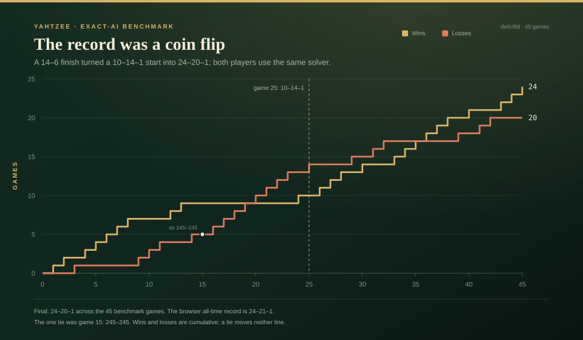
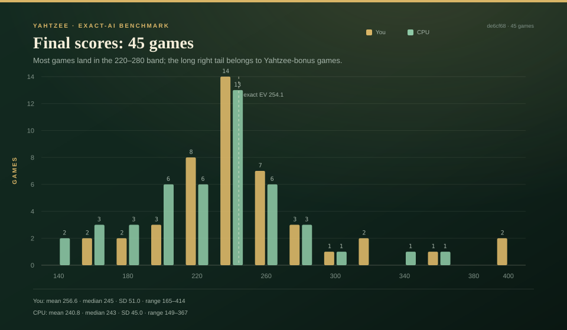
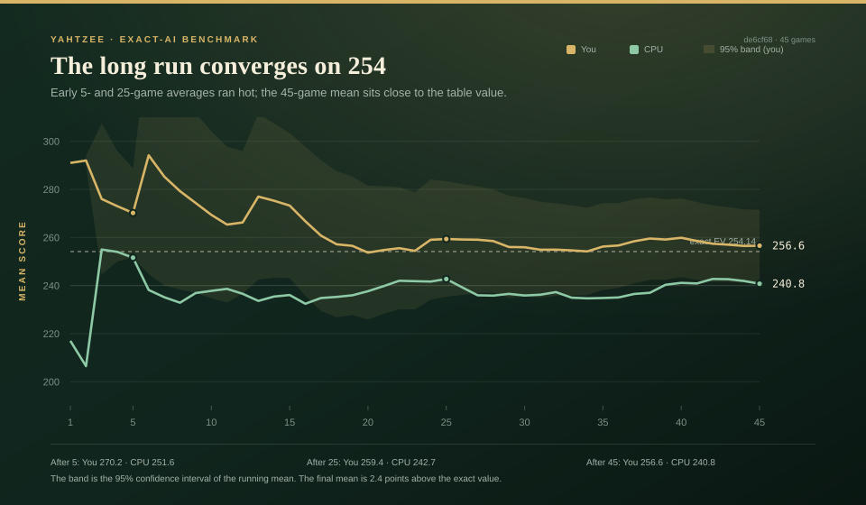
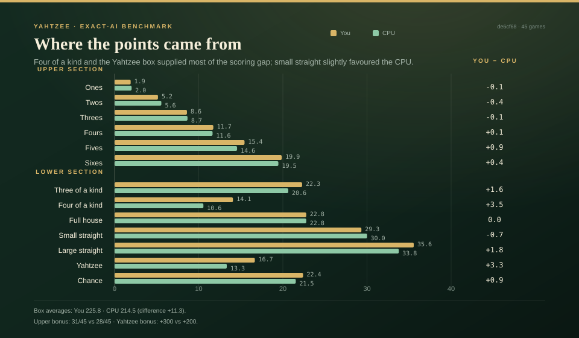

# Yahtzee Exact-W benchmark: 45 browser games + 100-game verification

> **Historical note:** these games were played against the Exact-W build at
> commit `de6cf68`, before Match-W was wired into the browser CPU. The current
> CPU switches to Match-W in rounds 12–13; the 45-game record is therefore a
> benchmark of the earlier Exact-W endgame, not the current shipped behavior.

**Bottom line:** the 45-game browser benchmark finished **24 wins, 20 losses, 1 tie**. I averaged **256.58** against the computer's **240.76**, a mean margin of **+15.82** points. But the 95% interval on that margin is **−6.41 to +38.05**, so the record is statistically indistinguishable from a coin flip.

A seeded **100-game headless rerun** with the same **Exact-W** model went **42–57–1**, averaging **253.88** to the computer's **257.25**. The record flipped; the mean did not. Exact-W is exact for expected score, not for winning a particular match.

The 20-game extension went **14–6** and pulled the overall record above .500. The previous 25-game sample was **10–14–1**. Same strategy, same table, very different records — a clean demonstration of how much of Yahtzee is dice variance.

## What was played

- **Build:** the deployed GitHub Pages game at commit `de6cf68`, <https://slayyyyer.github.io/yahtzee/>.
- **Strategy:** every player hold and every box choice came from the shipped exact `W(B,u,y)` table — the same solver the computer uses. I did not use a greedy "highest score now" policy.
- **Sample:** 45 complete 13-round games: the original 5, a middle batch of 20, and the final batch of 20 requested here.
- **Harness:** browser automation clicked the real dice, hold, roll and scorecard controls. The later batches accelerated animation timers to keep the run practical; dice generation, solver decisions, scoring and turn order were untouched.
- **No game-code changes** were made during the benchmark.

## The playing model

The decisions were made by **Exact-W**, not by a browser and not by an LLM:

| field | value |
| --- | --- |
| model | **Exact-W** |
| type | exact finite-horizon dynamic programming; expected-score maximizer |
| state | `B` = open boxes, `u` = upper total capped at 63, `y` = Yahtzee box closed at 50 |
| future table | 1,048,576 entries; `W(8191,0,0) = 254.143784` |
| turn policy | choose the hold that maximizes expected final score; stop when holding all five is best; bank the box that maximizes `score + W(next state)` |
| tie-break | deterministic first best |
| 45 browser games | exact engine, browser harness, unseeded `Math.random` dice |
| 100 verification games | exact engine, headless Node/Bun, Mulberry32 seed `20261028` |

No language model chose a hold or a box. The LLM orchestration only launched the benchmark and collected the results.

## Headline numbers

| metric | You | CPU | Difference |
|---|---:|---:|---:|
| games | 45 | 45 | — |
| record | **24–20–1** | **20–24–1** | — |
| win rate | **53.3%** | 44.4% | — |
| mean score | **256.58** | 240.76 | **+15.82** |
| median score | 245 | 243 | median margin +11 |
| standard deviation | 51.00 | 45.01 | — |
| 95% CI for the mean | 241.26–271.90 | 227.23–254.28 | margin −6.41 to +38.05 |
| minimum | 165 | 149 | — |
| maximum | 414 | 367 | — |
| exact expected score | 254.143784 | 254.143784 | 0 |

The exact full-card value is **254.143784**. The 45-game mean of 256.58 is 2.43 points above it, and its 95% interval comfortably contains it. The CPU's 240.76 is 13.39 below the exact value, and its interval just barely reaches 254.28. Nothing here suggests the player found a strategic edge over the solver.

The browser's all-time record is **24–21–1**, not 24–20–1: it still includes the earlier 94–217 verification game. The 45 benchmark games themselves are 24–20–1.

## The record was a coin flip

| session | games | record | your mean | CPU mean | mean margin |
|---|---:|---:|---:|---:|---:|
| initial sample | 5 | 4–1 | 270.20 | 251.60 | +18.60 |
| middle 20 | 20 | 6–13–1 | 256.65 | 240.50 | +16.15 |
| final 20 | 20 | **14–6** | 253.10 | 238.30 | +14.80 |
| **all 45** | **45** | **24–20–1** | **256.58** | **240.76** | **+15.82** |

The final 20 games look like a hot streak, and the middle 20 look like a cold streak. The strategy did not change. The middle batch went 6–13–1 despite a *higher* mean margin (+16.15) than the final batch (+14.80) — a reminder that mean score and win/loss record are not the same thing. Close losses and blowout wins can produce a positive average margin with a losing record.

The mean margin is **+15.82**, but the median margin is only **+11**, and the margin standard deviation is **73.99**. One 243-point win (414–171) pulls the average upward. The 95% interval on the mean margin includes zero, and the paired t-statistic is about **1.44** (df 44), so the data do not support a repeatable advantage.

## Score distribution

- Both distributions peak in the **240–259** bin: 14 player games and 13 CPU games.
- The player has the longer right tail: **2 games of 400+** (414 and 406), **3 of 350+**, and **6 of 300+**. The CPU had **3 games of 300+**, **2 of 350+**, and a maximum of **367**.
- The CPU had more sub-200 games: **8** versus the player's **4**.
- The player's larger standard deviation (51.00 vs 45.01) is mostly the Yahtzee-bonus tail. Three extra-Yahtzee bonuses produced 300 player bonus points; the CPU had 200.

The running mean shows why the early records were misleading: the 5-game average was 270.2, the 25-game average was 259.4, and the 45-game average settled at 256.6. The 95% band around the running mean narrows as the sample grows, and the final mean sits 2.4 points above the exact value.

The sample mean is close to the 5,000-game seeded self-play mean of **254.16** reported in the README. This 45-game run does not replace that larger measurement; it is a smaller, independent check on the deployed build.

## Where the points came from

| box | You | CPU | You − CPU |
|---|---:|---:|---:|
| Ones | 1.91 | 2.02 | −0.11 |
| Twos | 5.16 | 5.56 | −0.40 |
| Threes | 8.60 | 8.67 | −0.07 |
| Fours | 11.73 | 11.64 | +0.09 |
| Fives | 15.44 | 14.56 | +0.89 |
| Sixes | 19.87 | 19.47 | +0.40 |
| **Upper subtotal** | **62.71** | **61.91** | **+0.80** |
| Three of a kind | 22.29 | 20.64 | +1.64 |
| Four of a kind | 14.07 | 10.56 | **+3.51** |
| Full house | 22.78 | 22.78 | 0.00 |
| Small straight | 29.33 | 30.00 | −0.67 |
| Large straight | 35.56 | 33.78 | +1.78 |
| Yahtzee | 16.67 | 13.33 | +3.33 |
| Chance | 22.40 | 21.53 | +0.87 |
| **Lower subtotal** | **163.09** | **152.62** | **+10.47** |
| **Box total** | **225.80** | **214.53** | **+11.27** |
| Upper bonus | +24.11 | +21.78 | +2.33 |
| Yahtzee bonus | +6.67 | +4.44 | +2.22 |
| **Final mean** | **256.58** | **240.76** | **+15.82** |

The largest box edges were **four of a kind (+3.51)**, **Yahtzee (+3.33)**, **large straight (+1.78)**, **three of a kind (+1.64)**, **fives (+0.89)** and **chance (+0.87)**. The CPU was slightly better in small straight (−0.67), twos (−0.40), ones (−0.11) and threes (−0.07). Full house was dead even.

The bonus columns are per-game equivalents:

- Upper bonus: **31/45** player games (68.9%) versus **28/45** CPU games (62.2%). That is three extra bonuses, worth **105 points**, or **2.33 per game**.
- Extra Yahtzees: **300** player bonus points versus **200** CPU, or **2.22 per game**.
- The two bonuses together account for **4.55** of the 15.82 mean margin. The other **11.27** came from the boxes, concentrated in the lower section.

These category gaps are **descriptive, not causal**. Both players used the same policy; the differences are which dice arrived on which turns. A 45-game sample is far too small to identify a real policy edge from category averages, and there is no mechanism for one here.

## Round-by-round

Average cumulative score after each round:

| round | You | CPU | lead |
|---:|---:|---:|---:|
| 1 | 20.4 | 17.4 | +3.0 |
| 2 | 39.2 | 41.1 | −1.9 |
| 3 | 58.9 | 62.0 | −3.1 |
| 4 | 76.8 | 83.0 | −6.2 |
| 5 | 98.3 | 103.7 | −5.5 |
| 6 | 116.5 | 121.6 | −5.2 |
| 7 | 132.6 | 138.4 | −5.7 |
| 8 | 153.0 | 154.5 | −1.5 |
| 9 | 172.5 | 171.5 | +1.0 |
| 10 | 198.4 | 195.5 | +2.9 |
| 11 | 220.9 | 211.4 | +9.5 |
| 12 | 240.7 | 227.1 | +13.6 |
| 13 | 256.6 | 240.8 | +15.8 |

The CPU led through the middle of the average game. The player did not take the lead until round 9, then built the final margin in rounds 10–13. That late separation is a description of this sample, not a strategy: the same solver was on both sides, and the final 20 games are the ones that turned the record around.

## Independent 100-game headless verification

To remove the browser from the loop and make the sample reproducible, I reran the match with [`tools/benchmark-match.js`](../tools/benchmark-match.js). Both sides use the same exact table; only the dice are independent.

| metric | You | CPU |
|---|---:|---:|
| record | **42–57–1** | **57–42–1** |
| win rate | **42%** | 57% |
| mean | **253.88** | 257.25 |
| median | 242.5 | 257.5 |
| standard deviation | 64.67 | 57.16 |
| 95% CI for the mean | 241.05–266.71 | 245.91–268.59 |
| range | 136–526 | 143–427 |
| upper bonus | 69/100 | 72/100 |
| Yahtzee bonus points | 1100 | 800 |

Mean margin: **−3.37**, 95% CI **−22.39 to +15.65**, paired t **−0.35**. The player mean is **0.26 below** the exact value; the CPU mean is **3.11 above** it. Both confidence intervals contain **254.143784**.

The category leaders flipped between samples. In the 100-game run the CPU led four of a kind (14.86 vs 12.54), full house (22.75 vs 21.25) and the Yahtzee box (19 vs 15), while the player led large straight (33.20 vs 31.60) and three of a kind (22.86 vs 22.10). The 45-game browser sample had the opposite edges in four of a kind and Yahtzee. That is another sign that the category gaps are dice noise, not a policy difference.

The player had **1100** Yahtzee bonus points to the CPU's **800**, yet still averaged slightly less and lost more games. Extra Yahtzees raise variance; they do not guarantee a winning record.

This is the verification result: the 45-game **24–20–1** was a favorable sample. The 100-game headless sample is **42–57–1** with the same model. The mean stayed near 254 in both; the record did not stay positive.

## What this means

Exact play maximizes **expected final score**. It does not maximize the probability of beating another exact player: if both sides play the same optimal policy, the expected score difference is zero and the win/loss record is a dice-driven coin flip. The 45-game 24–20–1 sample and the 100-game 42–57–1 sample are two draws from that same process.

The earlier 5-game 4–1 result was a hot streak. The 25-game 10–14–1 sample was a cold one. The 45-game combination landed positive; the 100-game verification landed negative. The engine is still doing the right thing: its mean is pinned near 254, and no simple change to hold or box choices raises that expected value against this opponent.

### Is there a more optimal way to play?

It depends on the objective.

- **Maximize expected final score:** no. Exact-W is the full finite-horizon solution under these rules. The table already values every future box exactly, and the turn solver already checks every hold and every stop. There is no better expected-score policy in this state space.
- **Maximize the chance of winning a specific match:** yes, in principle. That is a different objective. The new [Match-W endgame report](yahtzee-matchw-2026-10-28.md) implements an exact version for the final two rounds. On 50 real round-12 states it raised the exact win probability by **+0.425 pp** (95% CI +0.235 to +0.615), and 40 of 50 states improved. The gain is real but small; a 100-game hybrid benchmark went **46–53–1**, which is inside the dice noise for a sub-percentage-point effect.
- **Against an identical Exact-W opponent:** no fixed policy can guarantee a positive edge. Match-W is provably at least as good as Exact-W from the same state under the exact opponent model, but it gives up about **5 points** of mean score to buy the small match-probability gain. The 100-game result is a reminder that expected-score play and win-probability play are not the same thing.

Official-rules Yahtzee is a separate case: the published value is **254.5896**, while this repo deliberately uses the permissive extra-Yahtzee rule and its exact value is **254.143784**.

## Validation and reproduction

- The table's full-card value is **254.143784**; the 45-game mean is **256.58**, with a 95% interval of **241.26–271.90** that contains it.
- The 100-game headless mean is **253.88**, only **0.26** below the exact value; its interval is **241.05–266.71**. The CPU mean is **257.25** (**+3.11**); its interval is **245.91–268.59**.
- The existing 5,000-game seeded self-play in the README reports **254.16 (SD 58.84)**. Both new samples point the same way on the mean.
- The 45-game record is **24–20–1**; the 100-game headless record is **42–57–1**. The all-time browser record is **24–21–1** because of one earlier verification loss.
- Raw score arrays and category averages: [yahtzee-benchmark-data-45.json](yahtzee-benchmark-data-45.json).
- Generated report data: [yahtzee-benchmark-2026-10-28.json](yahtzee-benchmark-2026-10-28.json).
- 100-game headless data: [yahtzee-verification-100.json](yahtzee-verification-100.json).
- Chart/table generator: [tools/render-benchmark.js](../tools/render-benchmark.js). Run it with `node tools/render-benchmark.js` (Bun works too).
- Headless match verifier: [tools/benchmark-match.js](../tools/benchmark-match.js). Run it with `node tools/benchmark-match.js --games=100 --seed=20261028`.

## Limitations

- The report contains 45 browser games and 100 headless games, not the 5,000-game seeded run. The confidence intervals are wide, especially for the margin.
- The 45 browser games were played by an automation harness, not a human. Later batches accelerated animations; the rules, dice generation, solver calls and scoring were not changed.
- The 45-game browser run used one deployed build on one date; its dice RNG was not seeded, so that exact sample is not reproducible, only the method is.
- The 100-game headless run uses the repo engine and table, not the deployed page. Rerunning seed `20261028` reproduced the same 100 games and the same summary.
- The 45 browser JSON records final scores and upper-section totals; full per-game scorecards were not retained. The 100-game JSON records full per-game cards and category scores.
- "Maximize win probability against a human" is a different objective and is not solved by this table.

## All 45 games

| # | You | CPU | Result | Margin | Upper (you / CPU) |
|---:|---:|---:|:---:|---:|---:|
| 1 | 291 | 217 | Win | +74 | 70 / 59 |
| 2 | 293 | 196 | Win | +97 | 63 / 41 |
| 3 | 244 | 352 | Loss | -108 | 66 / 60 |
| 4 | 264 | 251 | Win | +13 | 71 / 66 |
| 5 | 259 | 242 | Win | +17 | 64 / 67 |
| 6 | 414 | 171 | Win | +243 | 69 / 57 |
| 7 | 232 | 217 | Win | +15 | 69 / 57 |
| 8 | 237 | 217 | Win | +20 | 57 / 50 |
| 9 | 235 | 269 | Loss | -34 | 63 / 68 |
| 10 | 225 | 246 | Loss | -21 | 65 / 67 |
| 11 | 225 | 247 | Loss | -22 | 63 / 68 |
| 12 | 276 | 214 | Win | +62 | 71 / 61 |
| 13 | 406 | 198 | Win | +208 | 64 / 64 |
| 14 | 253 | 259 | Loss | -6 | 72 / 63 |
| 15 | 245 | 245 | Tie | 0 | 65 / 65 |
| 16 | 169 | 178 | Loss | -9 | 54 / 65 |
| 17 | 165 | 273 | Loss | -108 | 62 / 66 |
| 18 | 196 | 243 | Loss | -47 | 54 / 63 |
| 19 | 245 | 248 | Loss | -3 | 68 / 70 |
| 20 | 200 | 270 | Loss | -70 | 60 / 71 |
| 21 | 276 | 282 | Loss | -6 | 65 / 65 |
| 22 | 272 | 289 | Loss | -17 | 64 / 64 |
| 23 | 230 | 238 | Loss | -8 | 68 / 69 |
| 24 | 365 | 238 | Win | +127 | 52 / 63 |
| 25 | 267 | 268 | Loss | -1 | 65 / 69 |
| 26 | 254 | 154 | Win | +100 | 52 / 51 |
| 27 | 257 | 149 | Win | +108 | 65 / 62 |
| 28 | 243 | 232 | Win | +11 | 56 / 38 |
| 29 | 187 | 257 | Loss | -70 | 51 / 56 |
| 30 | 253 | 216 | Win | +37 | 56 / 53 |
| 31 | 224 | 246 | Loss | -22 | 53 / 57 |
| 32 | 256 | 271 | Loss | -15 | 65 / 66 |
| 33 | 245 | 161 | Win | +84 | 69 / 60 |
| 34 | 240 | 225 | Win | +15 | 64 / 64 |
| 35 | 325 | 240 | Win | +85 | 65 / 66 |
| 36 | 272 | 243 | Win | +29 | 71 / 58 |
| 37 | 322 | 289 | Win | +33 | 65 / 63 |
| 38 | 301 | 255 | Win | +46 | 65 / 64 |
| 39 | 244 | 367 | Loss | -123 | 55 / 67 |
| 40 | 288 | 272 | Win | +16 | 65 / 67 |
| 41 | 206 | 231 | Loss | -25 | 63 / 62 |
| 42 | 210 | 319 | Loss | -109 | 49 / 71 |
| 43 | 240 | 239 | Win | +1 | 58 / 66 |
| 44 | 234 | 210 | Win | +24 | 65 / 52 |
| 45 | 261 | 190 | Win | +71 | 66 / 65 |

**Totals:** 24 wins, 20 losses, 1 tie. Mean **256.58–240.76**.
