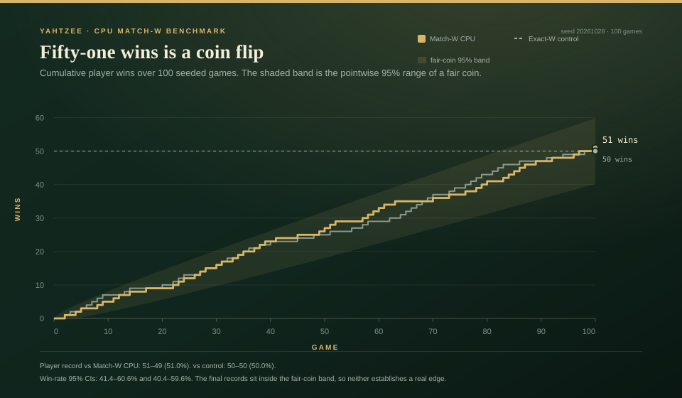
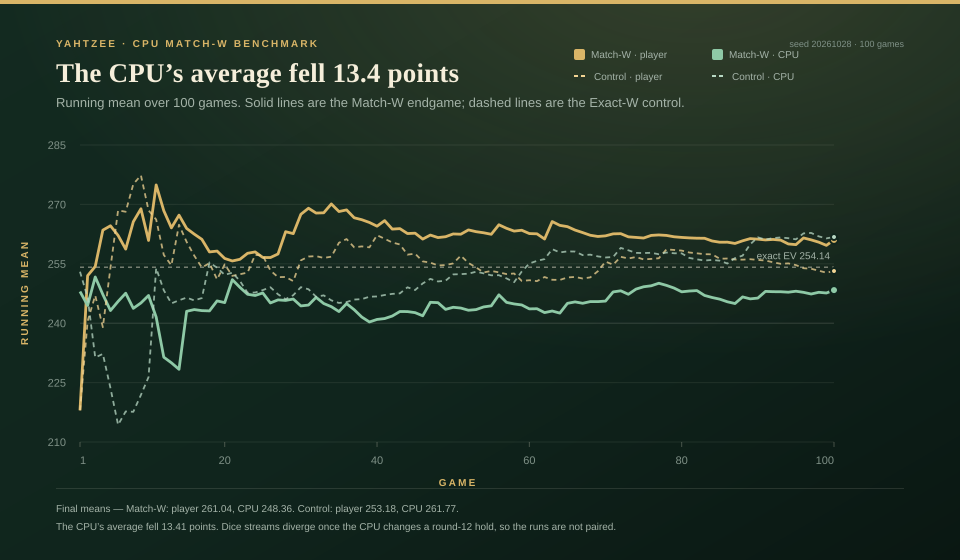
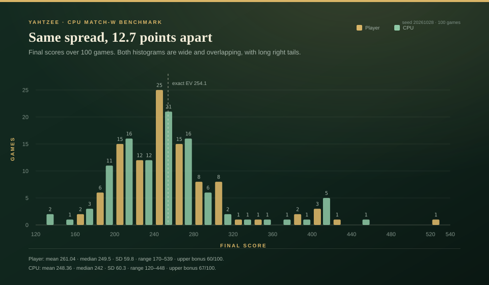
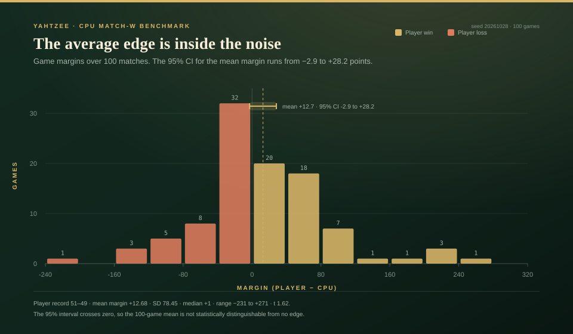

# CPU Match-W: 100-game head-to-head benchmark

**Bottom line:** 100 seeded games with an **Exact-W** player against the
**shipped CPU** — Exact-W through round 11, Match-W in rounds 12–13 — finished
**51–49–0 in the player's favor**. The player averaged **261.04**; the CPU
averaged **248.36**. The mean margin was **+12.68** for the player (95% CI
**−2.88 to +28.24**, per-game t **1.62**), so the 100-game score difference
is not statistically significant.

The Exact-W control, using the same player and seed, finished **50–50–0** with
player **253.18** and CPU **261.77**. The two runs are **not paired after round
12**: whenever the CPU takes a different Match-W action, it consumes a different
number of dice from the shared PRNG, so later games use a different dice stream.
The record difference (one game) is noise; the exact state-level result in the
[Match-W report](yahtzee-matchw-2026-10-28.md) is the sharper measurement.

## Models used

| side | model |
| --- | --- |
| Player | **Exact-W**: exact expected-score dynamic programming over the shipped `W(B,u,y)` table. |
| CPU | **Exact-W rounds 1–11; Match-W rounds 12–13**: maximize `P(CPU wins) + 0.5 × P(tie)` with both cards tracked. |
| CPU's opponent model | The player is assumed to use Exact-W in the remaining endgame; at round 12 the player's last category is forced. |
| Dice | Seeded Mulberry32 PRNG; no browser and no LLM in the decision loop. |

## Results

| metric | Exact-W control | CPU Match-W |
|---|---:|---:|
| games | 100 | 100 |
| record (player) | **50–50–0** | **51–49–0** |
| player win rate | 50.0% | 51.0% |
| player win-rate 95% CI | 40.4–59.6% | 41.4–60.6% |
| player mean | 253.18 | **261.04** |
| player SD | 60.74 | 59.81 |
| CPU mean | 261.77 | **248.36** |
| CPU SD | 66.75 | 60.34 |
| mean margin | −8.59 | **+12.68** |
| margin 95% CI | −26.83 to +9.65 | −2.88 to +28.24 |
| upper bonus games | 68 / 100 vs 68 / 100 | 60 / 100 vs 67 / 100 |
| Yahtzee bonus points | 1100 vs 1300 | 1100 vs 1000 |
| wall-clock elapsed | 1.1 s | 66.3 s |
| per game | 11.0 ms | 663.4 ms |

The control reproduces the earlier Exact-W control exactly
(`50–50–0`, 253.18 vs 261.77), so the benchmark harness and seed are consistent.

## Charts



**The record is inside the noise.** Both cumulative lines stay inside the
pointwise 95% band of a fair coin. Match-W finishes at 51 wins (one above the
coin's expected 50); the Exact-W control finishes at 50.



**The CPU's average fell 13.4 points.** Solid lines are the Match-W endgame,
dashed lines the control. The Match-W CPU ends at 248.36 against the control's
261.77, while the player's average rises from 253.18 to 261.04. These are
descriptive because the dice streams are not paired after the first different
endgame hold.



**The distributions overlap over most of their range.** Both sides have long
right tails and similar spread (player SD 59.8, CPU SD 60.3). The 12.7-point
difference in means is a shift within very noisy individual games, not a
separation of the distributions.



**The average margin is inside the noise.** The most common margin band is
0 to +39 (32 games), but the 95% CI of the mean margin runs from −2.9 to +28.2
and crosses zero. The 100-game result alone does not establish a real edge.

Direct links: [record race](charts/cpu-matchw-record-race.svg) ·
[running means](charts/cpu-matchw-running-average.svg) ·
[score distributions](charts/cpu-matchw-score-distribution.svg) ·
[margin distribution](charts/cpu-matchw-margin-distribution.svg).

## What the result means

Match-W is **not** an expected-score policy. It deliberately gives up points
when the scoreboard makes a lower-scoring line more likely to win the match.
The CPU's average fell from **261.77 to 248.36** in this sample, while the
player's average rose because the dice streams diverged after the CPU's first
different endgame decision. Neither mean is a paired estimate of the policy's
effect.

A 100-game win-rate sample has a standard error of roughly **5 percentage
points** for a 50% process. A one-game record difference — 51–49 versus 50–50 —
cannot distinguish a policy improvement of a few tenths of a percentage point
from dice noise. The exact replay comparison is the right test for that, not
the record.

## Exact policy check

A separate exact evaluator was used on **20 round-12 states from the same seed**
to compare the CPU Match-W value with the value of fixing the CPU to Exact-W
under the same match utility and the same Exact-W player model. Match-W was
**at least as high on all 20 states**; the largest measured gain was **7.02
percentage points**, and the minimum difference was zero. This confirms the
solver is making the intended trade rather than simply scoring badly.

The evaluator was a temporary verification script, not part of the committed
benchmark tooling.

## Reproduce

```bash
# 100-game CPU-role Match-W treatment
node tools/benchmark-cpu-matchw.js --games=100 --seed=20261028 \
  --cpu=matchw --out=reports/yahtzee-cpu-matchw-100.json

# 100-game Exact-W control
node tools/benchmark-cpu-matchw.js --games=100 --seed=20261028 \
  --cpu=exact --out=reports/yahtzee-cpu-exact-control-100.json

# rebuild the four charts from the two JSON files
node tools/render-cpu-matchw-charts.js
```

Raw data:

- [CPU Match-W 100 games](yahtzee-cpu-matchw-100.json)
- [Exact-W control 100 games](yahtzee-cpu-exact-control-100.json)

## Limitations

- One seed and 100 games; the record is descriptive and too small to resolve a
  sub-percentage-point effect.
- The treatment and control are not paired after round 12 because different
  holds consume different numbers of dice. The exact 20-state check is the
  policy-level verification; the 100-game table is a realistic whole-game run.
- The player is a fixed Exact-W model, not a human. The CPU's Match-W policy
  explicitly assumes that model in the remaining endgame.
- The CPU-role solver is exact only through rounds 12–13. Rounds 1–11 remain
  Exact-W.
